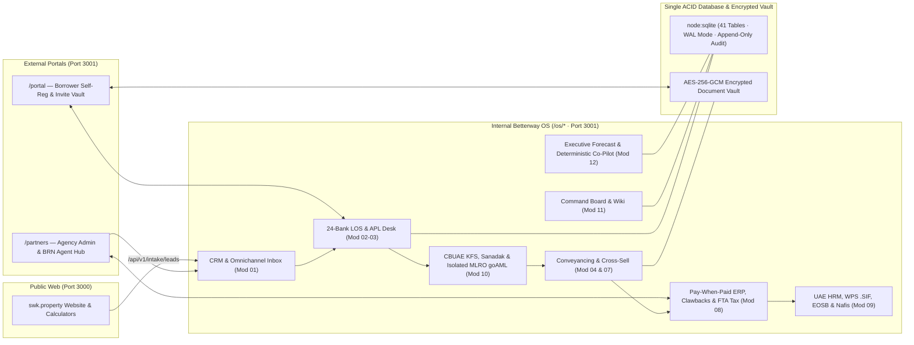

# Betterway OS — Technical Architecture & Unified 12-Module System Design

> [!IMPORTANT]
> **Ready for Design Sign-Off:** This specification incorporates all six of your product, commercial, and portal governance decisions alongside the findings from an independent principal-engineer architecture review. Once approved, we will write the step-by-step execution plan and build **Wave 1 → Wave 4** sequentially in `C:\Users\shamh\.gemini\antigravity\scratch\betterway-os` until all 12 modules are live.

---

## 1. Intent, Scope & Why We Are Building This

**Betterway OS** is the standalone, single-company proprietary Operating System for **Betterway Mortgages** (`Al Nasr Plaza, Oud Metha, Dubai, UAE`), running independently from the public marketing site ([swk.property](file:///C:/Users/shamh/.gemini/antigravity/scratch/swk.property)).

While horizontal platforms (**Odoo Enterprise**, **Zoho One**, **Bitrix24**) lack UAE mortgage underwriting math, tower-level Approved Project Lists (`APL`), Contract F / DLD Trustee conveyancing workflows, and bank clawback sub-ledgers—and PropTech rivals (**Huspy**, **Holo**) lock their internal OS behind closed brokerage walls—**Betterway OS** unifies **all 12 operational, financial, HR, and regulatory modules on a single ACID relational database** with zero cross-app sync lag and zero per-seat SaaS fees.

---

## 2. Goals, Non-Goals & Anti-Goals

### 2.1 Goals
1. **End-to-End Single Source of Truth:** One relational schema connecting Omnichannel CRM → 24-Bank CBUAE Underwriting (`LOS`) → Tower `APL` & Rate Governance → RERA Conveyancing & 72h Trustee Cheque Splits → Client Smart Vault & 90-Day Pre-Revert Radar → Two-Tier B2B RERA Partner Hub → 360° Cross-Sell → Double-Entry Mortgage ERP (Pay-when-paid Commissions, House Clawback Provision & Next-Deal Offset Recovery, FTA `5%` VAT, `9%` Corporate Tax, Peppol `PINT-AE` `UBL 2.1 XML`) → UAE HRM (MOHRE `WPS .SIF`, Basic-Pay `EOSB` Gratuity, `Nafis`/`GPSSA` & Advisor Draw/Commission Payroll) → CBUAE `KFS` / `goAML` Compliance → Internal Wiki & Deterministic AI Co-Pilot.
2. **Zero-Friction Local & `.zip` Portability:** Boots cleanly on Windows (`http://localhost:3001`, alongside `swk.property` on `port 3000`) via `npm install && npm run build && npm start` with **zero Docker containers, external DB daemons, or C++ `node-gyp` build dependencies**.
3. **Institutional UAE Compliance & Privacy Walls:**
   - Enforces CBUAE `50%` DBR, statutory LTV tiers, `25-year` max tenure, and `1%` / `AED 10,000 + 5% VAT` early-settlement cap.
   - Hard-blocks bank submission until **every obligated applicant (`PRIMARY`, `CO_BORROWER`, `GUARANTOR`)** has digitally signed the **CBUAE Key Facts Statement (`KFS`)** and cleared `CDD`/`EDD`.
   - Enforces strict Chinese walls: **MLRO-only isolation** on `goaml_reports` (`STR`/`SAR` vault) to prevent illegal "tipping off", and **Agency Owner vs. Individual BRN Agent isolation** on `/partners` (agents see milestone stages on their own leads only—never colleague deals, corporate IBANs, or client payslips/bank statements).
4. **Full Bilingual (`EN` LTR / `العربية` RTL) Corporate UI:** Midnight Banking Navy (`#021125`), Alabaster (`#F8F9FA`), Sovereign Gold (`#D7B04E` / `#8A6518`), `Inter` + `IBM Plex Sans Arabic` + `JetBrains Mono` tabular numbers.

### 2.2 Non-Goals
- **No Multi-Tenant SaaS Overhead:** Built strictly for Betterway Mortgages (`company_settings` singleton).
- **No Paid External API Keys Required to Run Locally:** WhatsApp, CTI telephony, UAE PASS, Peppol ASP transmission, sanctions feeds, and statement/policy assistants use clean adapter interfaces backed by **deterministic local engines and real file exporters (`.SIF`, `PINT-AE UBL 2.1 XML`, `goAML XML`, print-ready bilingual HTML/PDF packs)** that swap to live credentials via `.env` when desired.
- **No Edits Required in `swk.property`:** `swk.property` remains untouched; `betterway-os` exposes `/api/v1/intake/leads` with HMAC/CORS support ready to receive public website calculator/qualifier leads.

### 2.3 Anti-Goals
- **Zero Fake/Static Dashboard Arrays:** Every chart, table, kanban card, invoice, `.SIF` file, and audit log reads and writes real relational SQLite rows inside ACID transactions.
- **Zero LLM Freehand Arithmetic:** Every dirham, basis point, DBR, EMI, VAT box, Corporate Tax bracket, commission split, clawback offset, WPS `.SIF` row, and gratuity day is computed by unit-tested TypeScript functions using **integer UAE fils (`1 AED = 100 fils`)**.

---

## 3. Approaches Considered

| Approach | Summary | Trade-offs | Outcome |
| :--- | :--- | :--- | :--- |
| **Option A: Monorepo Inside `swk.property`** | Mount `/os`, `/portal`, `/partners` inside the public website repo. | Couples public SEO/marketing builds with internal regulated ERP/HRM/AML code. | Rejected |
| **Option B: Standalone Single-Company OS (`scratch/betterway-os`)** | Dedicated full-stack repository for Betterway's internal desks, Client Portal, and B2B Partner Hub on one unified database. | Hard security boundary, independent `.zip` and deployment lifecycle, zero multi-tenant bloat. | **Selected** |
| **Option C: Custom LOS + External Odoo/Zoho Sync** | Custom origination synced to external Zoho Books / Odoo. | Re-introduces multi-app sync failures, lacks native clawback/pay-when-paid sub-ledgers, adds SaaS fees. | Rejected |

---

## 4. Locked Decisions (User Choices vs. Builder Calls)

### 4.1 Decisions Decided by You
1. **Standalone Repository:** `C:\Users\shamh\.gemini\antigravity\scratch\betterway-os` (`port 3001`), separate from `swk.property`.
2. **Single-Company Scope:** Built exclusively for **Betterway Mortgages** (no multi-tenancy).
3. **Unified Schema + Sequential 4-Wave Build:** Complete 12-module schema created upfront in Wave 1; Waves `1 → 2 → 3 → 4` built and verified sequentially until all 12 modules are live.
4. **Pay-When-Paid & Bank-Subvention-Only B2B Splits:** Partner Agency splits (`SELF_BILLED_PARTNER`) and internal Advisor commissions become payable **strictly when bank commission cash is received/reconciled** (pro-rata on partial bank tranches). B2B Partner `split_bps` applies **exclusively to Bank Subvention**, never to `direct_client_fee_fils` (`100%` House + Advisor pool).
5. **100% Settlement Payout + House Clawback Provision + Next-Deal Offset:** Upon bank cash reconciliation, Partners and Advisors are paid `100%` of their earned share (no multi-year cash holdback). Betterway books a **House IFRS-15 Clawback Provision (`GL 2200`)** on its own balance sheet across the bank's `12/24/36-month` clawback window (amortising/releasing to income upon window expiry). If a bank claws back a loan early, the engine books recoverable **Partner & Advisor Clawback Debit Balances** that automatically deduct from their next settlement / payroll run.
6. **Two-Tier Partner Hub & Dual-Mode Client Portal:**
   - `/partners` separates **`PARTNER_AGENCY_ADMIN`** (Agency Owner/Principal: signs corporate ORN agreement, manages TRN/IBAN, views all agency BRNs' deals and corporate tax invoices) from **`PARTNER_AGENT`** (individual BRN: self-registers and drops leads immediately so zero viewing leads are lost, sees **only** their own privacy-masked deals, while commission payout remains gated until internal staff verify ORN/BRN + signed agreement).
   - `/portal` supports **both** prospective borrower self-registration (direct fact-find + Smart Vault) and Advisor-issued magic-link invites, with **every obligated applicant (`PRIMARY`, `CO_BORROWER`, `GUARANTOR`)** required to sign `kfs_acknowledgements` before passing the `IPA_SUBMITTED` gate.

### 4.2 Builder Technical Calls (Settled for Engineering & UAE Regulatory Precision)
1. **Framework & Native SQLite (`Builder Call`):** Next.js `15.5` (App Router) + React `19` + TypeScript `5.9` + Tailwind CSS `v4` + **Node.js `v26` built-in `node:sqlite` (`DatabaseSync` in `WAL` mode with `FOREIGN KEYS = ON`)**—zero native C++ build errors on Windows and instant `.zip` portability.
2. **Integer Fils & Basis Points (`Builder Call`):** All currency columns use integer fils (`1 AED = 100 fils`); rates use integer `bps` (`1.00% = 100 bps`); EIBOR fixings use `micro_pct` (`4.20677% = 420677`)—zero floating-point rounding drift.
3. **Advisor Slab & Draw Rollover Rules (`Builder Call`):** Added dedicated `advisor_comp_plans` & `advisor_comp_slabs` tables supporting marginal/progressive monthly `House Net` brackets, lead-source multipliers (`Self-Gen` vs. `Company/Partner Lead`), fixed/bps `progression_bonus_fils`, and **cumulative month-to-month `draw_deficit_fils` rollover** on recoverable draws until recouped.
4. **Bank Retro-Slab Month-End Revaluation (`Builder Call`):** When monthly volume with a bank crosses into a higher retro-tier in `bank_subvention_grids`, a deterministic `revalueMonthlyBankSubventions()` job posts positive accrual adjustments (`GL 1200 / GL 4100`) across that month's deals without mutating historical journal lines.
5. **UAE FTA VAT & Partial-Exemption Engine (`Builder Call`):** Under UAE Cabinet Decision No. 52 of 2017 (Art. 42), explicit fee/commission intermediation is defaulted to `EXCLUSIVE_5PCT` (`+5%` Output VAT on `GL 2300`), while per-bank config also supports `INCLUSIVE_5PCT`, `ZERO_RATED`, and `EXEMPT`—complete with `DIRECT_TAXABLE | DIRECT_EXEMPT | RESIDUAL_OVERHEAD` Input VAT tagging on `vendor_bills` so `VAT 201` handles FTA partial-exemption apportionment automatically if an exempt product ever arises.
6. **Day-1 `LEGACY_BACKBOOK` Cutover Importer (`Builder Call`):** Added `deals.origin_mode` (`LIVE` | `LEGACY_BACKBOOK`) + a CSV/JSON Back-Book Importer so Betterway can load previously closed mortgages straight into the **90-Day Pre-Revert Refinance Radar** and active **12–36m Clawback Watchlist** on Day 1 without triggering live KFS origination blocks or double-posting prior-year P&L and VAT.

---

## 5. System & Chinese-Wall Architecture

### 5.1 Nine-Role RBAC & Isolation Matrix

| Role | Entry Route | Key Capabilities & Strict Isolation Rules |
| :--- | :--- | :--- |
| `SUPER_ADMIN` | `/os/command` | Full access to all modules, company TRN/MOHRE settings, rate approvals, and audit logs. *(`goaml_reports` still requires `is_mlro = 1` flag).* |
| `SALES_ADVISOR` | `/os/crm` | Omnichannel leads, Fact-Find, 24-Bank Ranker, EN/AR Proposal Pack, Cross-sell referrals, own commission/draw statement. Cannot approve rates, post GL journals, or see other advisors' pay. |
| `CREDIT_UNDERWRITER` | `/os/los` | Full underwriting queue, AECB liability reconciler, Dual-Bank IPA builder, Statement Analyzer, and Maker/Checker (`can_approve_rates`) on `bank_rate_cards` & `bank_project_apl`. |
| `PROGRESSION_MANAGER` | `/os/conveyancing` | Contract F annexures, 10% Deposit Custody, Valuation & Appeal Pack, FOL Clause Audit, Seller Liability Letter 15d clock, Developer NOCs, 72h Trustee Cheque Splitter, Cross-sell completion. |
| `COMPLIANCE_MLRO` | `/os/compliance` | Multi-applicant KFS audit, CDD/EDD approvals, Sanctions/PEP screening, **`is_mlro = 1` exclusive `goAML` STR/SAR XML vault**, `Sanadak` SLA register, 10% monthly QA audits, full `audit_logs`. |
| `FINANCE_ADMIN` | `/os/erp` | Chart of Accounts, Double-Entry GL, Bank Bordereau Reconciler (triggers pay-when-paid waterfall!), House Clawback Provision & Partner/Advisor Offset Sub-Ledger, FTA `VAT 201`, `9%` CT, `PINT-AE` `UBL 2.1 XML`, Legacy Back-Book Importer. |
| `HR_MANAGER` | `/os/hrm` | Employee records, UAE Visa/EID/RERA expiry watchdog, Basic/Allowance contracts, Advisor comp plans & draw rollover, **MOHRE WPS `.SIF`** export, Basic-Salary EOSB accruals, `Nafis`/`GPSSA` tracker. |
| `PARTNER_AGENCY_ADMIN` | `/partners` | Signs corporate ORN Introducer Agreement, manages corporate TRN/IBAN, views **all** BRN agents' masked deals across their brokerage, downloads `SELF_BILLED_PARTNER` tax invoices & clawback offset statements. |
| `PARTNER_AGENT` | `/partners` | Self-registers with BRN, drops buyer leads immediately in 30s, generates Co-Branded QR/Links, views **only their own** privacy-masked deals (*never* colleague deals, corporate IBAN, or client payslips/AECB). |
| `CLIENT` | `/portal` | Self-registers or joins via invite; completes Fact-Find, uploads to encrypted Smart Vault, signs own `KFS` acknowledgement (joint co-borrowers sign individually), tracks 5 stages, accesses Homeowner Vault & 90-Day Pre-Revert Radar. |

---

## 6. Unified 41-Table Relational Schema (`src/server/db/schema.sql`)

All 41 tables initialize on Day 1 with foreign keys and check constraints:

1. **Core & Governance (4 tables):** `company_settings`, `users`, `sessions`, `audit_logs` *(append-only trigger prevents `UPDATE`/`DELETE`)*.
2. **CRM & B2B Partner Hierarchy (7 tables):** `partner_agencies` *(includes `verification_status`: `PENDING_ORN_CHECK` | `VERIFIED` | `SUSPENDED` and `clawback_debit_balance_fils`)*, `partner_agents` *(includes `is_agency_admin` `0|1`)*, `households`, `applicants`, `applicant_liabilities`, `leads`, `comm_messages`.
3. **24-Bank Policy, Rates, EIBOR & APL (6 tables):** `banks`, `bank_rate_cards` *(maker-checker `DRAFT` → `PENDING_APPROVAL` → `ACTIVE`)*, `eibor_fixings`, `developers`, `projects`, `bank_project_apl`, `bank_bdm_contacts` *(7 tables total in bank domain)*.
4. **LOS, Conveyancing, Vault, Radar & Cross-Sell (6 tables):** `deals` *(includes `origin_mode` = `'LIVE'` | `'LEGACY_BACKBOOK'`)*, `deal_submissions`, `conveyancing_cases`, `vault_documents` *(AES-256-GCM metadata + expiry/recency status)*, `homeowner_radar_monitors`, `cross_sell_referrals`.
5. **Pay-When-Paid ERP, Clawbacks & UAE Tax (9 tables):** `gl_accounts`, `gl_journal_entries`, `gl_journal_lines`, `bank_subvention_grids` *(includes `vat_mode`: `EXCLUSIVE_5PCT` | `INCLUSIVE_5PCT` | `ZERO_RATED` | `EXEMPT`)*, `bank_bordereau_batches`, `commission_settlements` *(tracks `expected` vs `received` bank cash, `output_vat_fils`, pay-when-paid `payable_release_ratio_bps`, `partner_split_fils` on bank subvention only, `partner_clawback_offset_applied_fils`, `advisor_commission_fils`, `advisor_clawback_offset_applied_fils`, `house_clawback_provision_fils`)*, `clawback_ledger` *(tracks House `GL 2200` provision lifecycle + recovery debit creation if triggered)*, `tax_invoices` *(with `pint_ae_xml`)*, `vendor_bills` *(with `input_vat_category`: `DIRECT_TAXABLE` | `DIRECT_EXEMPT` | `RESIDUAL_OVERHEAD` & CT deductibility)*.
6. **UAE HRM, Advisor Comp, WPS `.SIF` & EOSB (6 tables):** `advisor_comp_plans`, `advisor_comp_slabs`, `employees` *(includes `draw_deficit_fils`, `is_uae_national`, `nafis_registered`, `gpssa_number`, 14-digit `mohre_person_id`, 9-digit `routing_agent_id`, `iban`)*, `leave_records`, `payroll_runs` *(stores generated `.SIF` content)*, `payroll_lines`.
7. **CBUAE Compliance, `goAML` & Internal Ops (5 tables):** `kfs_acknowledgements` *(composite uniqueness per `deal_id` + `applicant_id` so every obligated applicant signs)*, `aml_screenings`, `goaml_reports` *(MLRO-isolated)*, `sanadak_complaints`, `wiki_articles`, `ops_tasks` *(6 tables; 41 tables total)*.

---

## 7. Exact Accounting & Lifecycle Rules (`Zero Ambiguity`)

1. **Disbursal (`TRANSFERRED_DISBURSED` on `LIVE` deal):**
   - Books **Accrued Bank Subvention Receivable**: `DR GL 1200 (Bank Subvention Receivable)` / `CR GL 4100 (Subvention Revenue)` + `CR GL 2200 (House IFRS-15 Clawback Provision, e.g., configurable 10%–15% estimate)` + `CR GL 2300 (FTA Output VAT 5% when EXCLUSIVE_5PCT)`.
   - Partner & Advisor commissions are recorded in `commission_settlements` with status `AWAITING_BANK_CASH` (**not** yet payable in `GL 2100`/`2150` or WPS `.SIF`).
   - Automatically creates the `homeowner_radar_monitors` row (`fixed_expiry_date`) and `clawback_ledger` watch row (`protected_until_date` = disbursal + bank's `12/24/36m` window).
2. **Bank Bordereau Cash Receipt (`Pay-When-Paid Trigger`):**
   - Finance records bank remittance (`DR GL 1100 Cash` / `CR GL 1200 Receivable`, pro-rata if partial tranche).
   - **Partner Waterfall (Bank Subvention Pool Only):** Computes `gross_partner_split = received_bank_subvention_ex_vat × split_bps`. Deducts any existing `partner_agencies.clawback_debit_balance_fils` first (`net_partner_payout`). If `partner_agencies.verification_status === 'VERIFIED'` and agreement is `SIGNED`, generates a `SELF_BILLED_PARTNER` tax invoice (`+5%` Input VAT if agency has a 15-digit `TRN`) and posts `GL 2100 Partner Payable`; otherwise holds in `ONBOARDING_HOLD` until ORN/BRN is verified.
   - **Advisor Waterfall (Bank Subvention Net of Partner Split + 100% of Direct Client Fee):** Applies progressive `advisor_comp_slabs` + lead-source multiplier, deducts any `advisor_clawback_debit_fils` and recoverable `employees.draw_deficit_fils`, and queues net variable pay into the next `payroll_runs` WPS `.SIF` cycle (`GL 2150`).
3. **Clawback Window Expiry vs. Early Bank Clawback:**
   - If the `12/24/36m` window expires without early settlement: `DR GL 2200 (House Clawback Provision)` / `CR GL 4100 (Released Revenue)`.
   - If the bank claws back commission early: reverses revenue/provision against bank cash/receivable, and posts contractual share to `partner_agencies.clawback_debit_balance_fils` and `employees` clawback recovery balance to auto-deduct from their next deal!

---

## 8. Four-Wave Implementation Roadmap

| Wave | Modules Delivered | Verification Gate |
| :--- | :--- | :--- |
| **Wave 1** | Scaffold `betterway-os` (`port 3001`), full **41-table SQLite schema + seeders**, 10-role RBAC Auth, **Mod 01 (CRM)**, **Mod 02 (24-Bank LOS & EN/AR Proposal Pack)**, **Mod 03 (Rate Maker-Checker, Live EIBOR & Tower APL)**, **Mod 04 (Conveyancing & 72h Cheque Splitter)**, and `/api/v1/intake/leads`. | Unit tests on `underwriting-engine` & `conveyancing-engine` + `next build` + live check. |
| **Wave 2** | AES-256-GCM Encrypted Vault, **Mod 05 (`/portal` Self-Reg + Invite, Multi-Applicant KFS E-Sign, Smart Vault & 90d Radar)**, **Mod 06 (`/partners` Agency Owner vs. BRN Agent Hub, Instant Lead Drop, Masked Tracker & Pre-Qual Letter)**, **Mod 07 (Commercial DSCR, HNW/SPV & 360° Cross-Sell)**, and **Legacy Back-Book CSV Importer**. | Unit tests on RBAC/Chinese-wall masking, multi-applicant KFS gate & encryption + `next build`. |
| **Wave 3** | **Mod 08 (Double-Entry ERP, Pay-When-Paid Waterfall, House Clawback Provision & Next-Deal Offset, FTA `VAT 201` w/ Partial Exemption, `9%` CT & Peppol `PINT-AE` `UBL 2.1 XML`)** and **Mod 10 (CBUAE KFS Hard-Gate, Sanctions/CDD, Isolated MLRO `goAML` XML Vault, `Sanadak` & Immutable Audit Log)**. | Unit tests on double-entry balance, pay-when-paid/clawback math, `PINT-AE` XML & MLRO isolation + `next build`. |
| **Wave 4** | **Mod 09 (UAE HRM, Expiry Watchdog, Advisor Slab/Draw Payroll, MOHRE `WPS .SIF` Generator, Basic-Pay `EOSB` Gratuity & `Nafis`/`GPSSA`)**, **Mod 11 (Morning Command Board, Bank Policy Wiki & Bilingual Templates)**, and **Mod 12 (Weighted Cash Forecast, Attribution BI, Bank Statement Analyzer & Citation Policy Co-Pilot)** + final `betterway-os.zip`. | Full end-to-end test suite, `next build`, live desktop/mobile browser audit on `localhost:3001`, and clean `.zip` delivery. |
